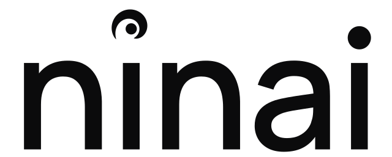

# Ninai

Continue project work across supported AI assistants with compact, source-backed memory. Ninai retrieves past decisions from projects you explicitly authorize and proposes durable outcomes for review. Every memory retains its source.

## Connect

Install this plugin in a supported host, then connect its Ninai connector to your hosted account through OAuth. Open the [Ninai control center](https://app.ninai.io/control), bind the connection, and grant only the project and capabilities you want it to use. A new connection starts without project access. In Claude chat and Cowork, use the plugin's Connectors tab to connect.

Try “Which Ninai projects can this connection read?” or “What decisions have we made about this project? Include sources.” The project-continuity skill guides project selection, bounded recall, and compact proposals. Direct activation requires an explicit auto-activate grant. You can revoke a connection or project grant in the control center.

## Data and limitations

This package connects only to the separate hosted vault at https://app.ninai.io/mcp. It never reads, uploads, or synchronizes the local Mac SQLite vault. Connecting tools does not guarantee automatic invocation or capture of every conversation. The assistant must preserve provenance, respect live grants, and keep credentials and raw conversation dumps out of memory. Hosted operational release gates and independent acceptance remain documented separately; this package does not establish directory approval.

## Support and policies

[Support](https://ninai.io/support/) · [Privacy](https://ninai.io/privacy/) · [Terms](https://ninai.io/terms/) · [Website](https://ninai.io/). Contact hello@ninai.io for help. Ninai's own website mark and wordmarks are bundled unchanged; this is a Ninai package for supported hosts, with no claim of endorsement by OpenAI or Anthropic.

## Package formats

The root manifest and mcp.json provide the portable Agent Plugins format with OpenAI listing metadata. The Codex compatibility manifest and Claude manifest support their respective hosts; .mcp.json supplies the Claude and Codex HTTP configuration. All components live inside this plugin folder. MIT licensed.
